# 🛡️ JARVIS V4: ESP32 Smart Gate & Multi-Door Electronic Lock Automation System

[](#)
[](#)
[-emerald.svg)](#)
[](#)
[](#)
[](#)

**JARVIS V4** হলো একটি পেশাদার, শিল্প-মানের (industrial-grade) স্মার্ট গেট এবং বহু-দরজা সমন্বিত ইলেকট্রনিক লক অটোমেশন সিস্টেম। এটি **ESP32-WROOM-32** মাইক্রোকন্ট্রোলারের মাধ্যমে পরিচালিত হয় এবং সম্পূর্ণ **Non-Blocking Architecture**-এ নির্মিত। নেটওয়ার্ক বা হোম অ্যাসিস্ট্যান্ট ব্রোকার ডাউন থাকলেও স্থানীয় ফিজিক্যাল পুশ বাটন, রিলে ও লিমিট সুইচ এক মিলি-সেকেন্ডের জন্যও হ্যাং বা বিলম্বিত হয় না।

---

## 📑 সূচিপত্র (Table of Contents)

1. [সিস্টেমের প্রধান বৈশিষ্ট্যসমূহ (Key Highlights)](#1-সিস্টেমের-প্রধান-বৈশিষ্ট্যসমূহ-key-highlights)
2. [সম্পূর্ণ সিস্টেমের ভিজ্যুয়াল আর্কিটেকচার (System Architecture)](#2-সম্পূর্ণ-সিস্টেমের-ভিজ্যুয়াল-আর্কিটেকচার-system-architecture)
3. [ESP32 বোর্ড ও পিন ম্যাপিং ডায়াগ্রাম (ESP32 Pin Map)](#3-esp32-বোর্ড-ও-পিন-ম্যাপিং-ডায়াগ্রাম-esp32-pin-map)
4. [মেইন গেট মোটর ও ড্রাইভার ওয়্যারিং (Main Gate Motor Driver)](#4-মেইন-গেট-মোটর-ও-ড্রাইভার-ওয়্যারিং-main-gate-motor-driver)
5. [৪-চ্যানেল ডোর ও গেট লক ড্রাইভার সার্কিট (Lock Actuator Drivers)](#5-৪-চ্যানেল-ডোর-ও-গেট-লক-ড্রাইভার-সার্কিট-lock-actuator-drivers)
6. [লক স্ট্যাটাস অপ্টোকপলার ও ১০kΩ পুল-ডাউন সার্কিট (Status Optocoupler Wiring)](#6-লক-স্ট্যাটাস-অপ্টোকপলার-ও-১০kω-পুল-ডাউন-সার্কিট-status-optocoupler-wiring)
7. [কিপ্যাড কলিং-বেল অপ্টোকপলার সার্কিট (Bell/Event Optocoupler Wiring)](#7-কিপ্যাড-কলিং-বেল-অপ্টোকপলার-সার্কিট-bellevent-optocoupler-wiring)
8. [পুশ বাটন, লিমিট সুইচ ও স্ট্যাটাস LED ওয়্যারিং (Buttons, Sensors & LED)](#8-পুশ-বাটন-লিমিট-সুইচ-ও-স্ট্যাটাস-led-ওয়্যারিং-buttons-sensors--led)
9. [পাওয়ার ডিস্ট্রিবিউশন, ফিউজ ও প্রোটেকশন সার্কিট (Power & Protection)](#9-পাওয়ার-ডিস্ট্রিবিউশন-ফিউজ-ও-প্রোটেকশন-সার্কিট-power--protection)
10. [যোগাযোগ আর্কিটেকচার: Home Assistant ও MQTT (Communication Architecture)](#10-যোগাযোগ-আর্কিটেকচার-home-assistant-ও-mqtt-communication-architecture)
11. [ফার্মওয়্যার কনফিগারেশন ও ফ্ল্যাশিং নির্দেশিকা (Flashing & Setup)](#11-ফার্মওয়্যার-কনফিগারেশন-ও-ফ্ল্যাশিং-নির্দেশিকা-flashing--setup)
12. [হার্ডওয়্যার প্রি-পাওয়ার-অন চেকলিস্ট (Pre-Power-On Verification)](#12-হার্ডওয়্যার-প্রি-পাওয়ার-অন-চেকলিস্ট-pre-power-on-verification)

---

## 1. সিস্টেমের প্রধান বৈশিষ্ট্যসমূহ (Key Highlights)

- 🔒 **৪টি স্বাধীন ইলেকট্রনিক লক নিয়ন্ত্রণ:** মেইন গেট সোলেনয়েড লক, বেডরুম ১ লক, বারান্দা লক এবং বেডরুম ২ লক।
- ⚙️ **দ্বিমুখী গেট মোটর নিয়ন্ত্রণ (Bi-Directional H-Bridge / Relays):** ফরওয়ার্ড (খোলা) ও রিভার্স (বন্ধ) এবং স্বয়ংক্রিয় সফটওয়্যার ইন্টারলক টাইমার।
- ⏱️ **নন-ব্লকিং সিকোয়েন্সিং:** গেট খোলার পূর্বে ১৫০০ms লক রিলিজ ইন্টারলক এবং গেট বন্ধের পর ২০০০ms পোস্ট-ক্লোজ রি-লকিং সিকোয়েন্স।
- 🛡️ **GPIO 17 হার্ডওয়্যার সমাধান:** বেডরুম ২ লকের জন্য ঝুঁকিপূর্ণ বুটস্ট্র্যাপিং পিন GPIO 5 সম্পূর্ণরূপে বর্জন করে নিরাপদ GPIO 17 ব্যবহার করা হয়েছে, ফলে পাওয়ার ফ্লিকারের পরও ESP32 বুট-লক হয় না।
- 🔌 **ইনপুট-অনলি পিনে ১০kΩ পুল-ডাউন প্রোটেকশন:** GPIO 34, 35, 36 (VP), ও 39 (VN) পিনে অভ্যন্তরীণ পুল-আপ/ডাউন সিলিকন সার্কিট্রি না থাকায় বাহ্যিক ১০kΩ রেজিস্টরের মাধ্যমে ফ্লোটিং নয়েজ দূর করা হয়েছে।
- 🔔 **দ্বিমুখী স্মার্ট কলিং বেল ইন্টিগ্রেশন:** কিপ্যাড বেল চাপলে দরজা খোলা থাকলে তৎক্ষণাৎ স্থানীয়ভাবে লক হয়ে যায়; আর দরজা ইতিমধ্যে লক থাকলে Home Assistant-এ নন-রিটেইন্ড MQTT প্রেস ইভেন্ট পাঠানো হয়।
- 📡 **জিরো-কনফিগ MQTT অটো-ডিসকভারি:** Home Assistant-এ স্বয়ংক্রিয়ভাবে ৫টি সত্ত্বা (Entities) কনফিগার হয়।
- 🌐 **ডুয়াল পোর্ট ওয়েব ইন্টারফেস:** পোর্ট ৮০-তে সার্বক্ষণিক মনিটরিং ড্যাশবোর্ড (`http://jarvis-v4.local/`) এবং পোর্ট ৮১-তে ফলব্যাক কনফিগারেশন পোর্টাল (`Jarvis_V4_Setup`)।
- 🐕 **৩-সেকেন্ড হার্ডওয়্যার ওয়াচডগ (WDT):** কোডের যেকোনো অপ্রত্যাশিত ব্লকিং রোধে স্বয়ংক্রিয় রিবুট ও সেলফ-হিলিং।

---

## 2. সম্পূর্ণ সিস্টেমের ভিজ্যুয়াল আর্কিটেকচার (System Architecture)

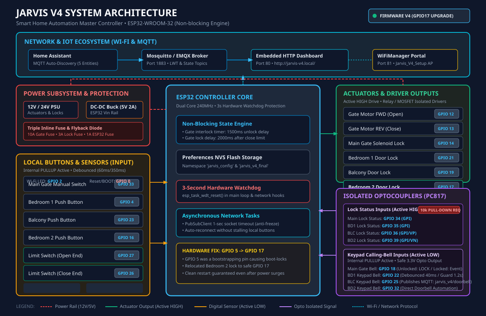

### ক. ছবির উদ্দেশ্য (Purpose)
এই ডায়াগ্রামটি সম্পূর্ণ JARVIS V4 সিস্টেমের হাই-লেভেল হার্ডওয়্যার কাঠামো প্রদর্শন করে। এতে দেখানো হয়েছে কীভাবে ESP32 কন্ট্রোলার তার পাওয়ার রেল, অ্যাকচুয়েটর ড্রাইভ, গ্যালভানিক আইসোলেটেড অপ্টোকপলার, লোকাল ইনপুট সুইচ এবং Wi-Fi/MQTT নেটওয়ার্কের সাথে সমন্বিতভাবে সংযুক্ত।

### খ. সাবসিস্টেম সংযোগ বিবরণ (Subsystem Connection Details)

| সাবসিস্টেম | ভোল্টেজ ডোমেইন | সিগন্যাল সংযোগ | আইসোলেশন ও প্রোটেকশন মেথড |
| :--- | :--- | :--- | :--- |
| **ESP32 MCU Core** | 3.3V Logic / 5V Vin | 20x GPIO পিন | 3s Hardware Watchdog, Preferences NVS |
| **Main Power PSU** | 220V AC -> 12V/24V DC | B+, PWR GND | AC MCB, MOV Surge Suppressor, 10A/3A/1A ফিউজ |
| **Gate Motor Driver** | 12V / 24V DC (10A) | GPIO 12 (FWD), GPIO 13 (REV) | H-Bridge / Dual 30A Relay, Flyback Snubber |
| **Lock Drivers (x4)** | 12V DC (3A) | GPIO 14, 21, 19, 17 | অপ্টো-আইসোলেটেড রিলে বোর্ড, 1N4007 ডায়োড |
| **Lock Status Feedback** | 12V Keypad Side -> 3.3V Logic | GPIO 34, 35, 36, 39 | PC817 অপ্টোকপলার + **১০kΩ বাহ্যিক পুল-ডাউন** |
| **Keypad Calling Bells** | 12V Keypad Side -> 3.3V Logic | GPIO 18, 22, 25, 32 | PC817 অপ্টোকপলার, অভ্যন্তরীণ পুল-আপ, 40ms ডিবউন্স |
| **Local Switches & Limits** | 3.3V Logic (Active LOW) | GPIO 33, 4, 23, 16, 27, 26 | অভ্যন্তরীণ 45kΩ পুল-আপ, 60ms/350ms সফটওয়্যার গার্ড |

### গ. সিস্টেম স্টেট মেশিন ফ্লোচার্ট (Mermaid Flowchart)

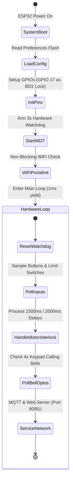

---

## 3. ESP32 বোর্ড ও পিন ম্যাপিং ডায়াগ্রাম (ESP32 Pin Map)

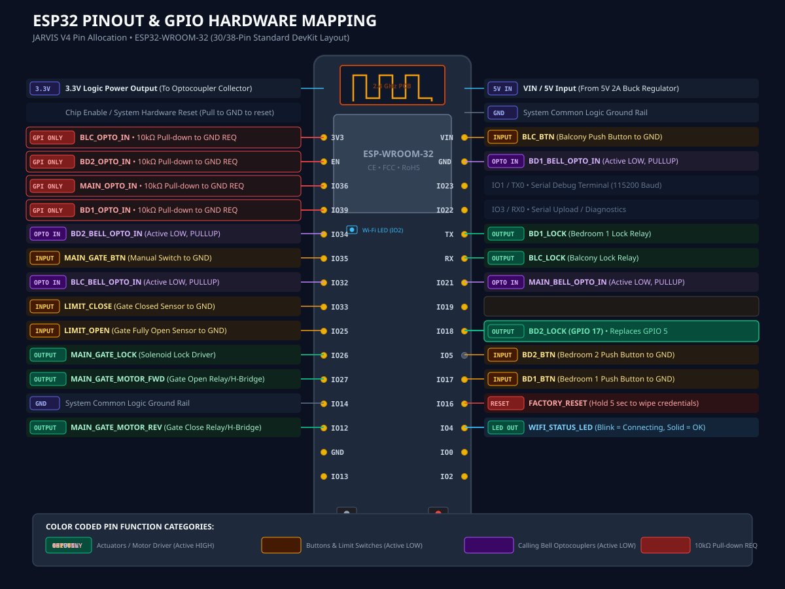

### ক. ছবির উদ্দেশ্য
ESP32-WROOM-32 ডেভেলপমেন্ট বোর্ডের (30/38 Pin) কোন ফিজিক্যাল পিন JARVIS V4-এর কোন কাজে বরাদ্দ করা হয়েছে, তার দিকনির্দেশ (Direction), ডিফল্ট স্টেট এবং গুরুত্বপূর্ণ সিলিকন সীমাবদ্ধতা স্পষ্টভাবে তুলে ধরা।

### খ. পিন-টু-পিন মাস্টার সংযোগ তালিকা (Master Pin Allocation Table)

| ESP32 GPIO | ফার্মওয়্যার ম্যাক্রো নাম | ডিরেকশন | ইন্টারনাল রেজিস্টর | বাহ্যিক সার্কিট ও উপাদান | লজিক লেভেল | যাচাই স্ট্যাটাস |
| :---: | :--- | :---: | :---: | :--- | :---: | :---: |
| **IO 12** | `MAIN_GATE_MOTOR_FWD` | OUTPUT | নেই | গেট ওপেন রিলে / H-Bridge IN1 | HIGH = Run | `[নিশ্চিত]` |
| **IO 13** | `MAIN_GATE_MOTOR_REV` | OUTPUT | নেই | গেট ক্লোজ রিলে / H-Bridge IN2 | HIGH = Run | `[নিশ্চিত]` |
| **IO 14** | `MAIN_GATE_LOCK` | OUTPUT | নেই | মেইন গেট সোলেনয়েড রিলে IN | HIGH = Actuate | `[নিশ্চিত]` |
| **IO 21** | `BD1_LOCK` | OUTPUT | নেই | বেডরুম ১ লক রিলে IN | HIGH = Actuate | `[নিশ্চিত]` |
| **IO 19** | `BLC_LOCK` | OUTPUT | নেই | বারান্দা লক রিলে IN | HIGH = Actuate | `[নিশ্চিত]` |
| **IO 17** | `BD2_LOCK` | OUTPUT | নেই | বেডরুম ২ লক রিলে IN *(GPIO 5 বাদ)* | HIGH = Actuate | `[নিশ্চিত]` |
| **IO 34** | `MAIN_OPTO_IN` | **GPI ONLY** | **নেই (সিলিকন সীমাবদ্ধতা)** | PC817 Emitter + **১০kΩ Pull-Down** | HIGH = Active | `[নিশ্চিত]` |
| **IO 35** | `BD1_OPTO_IN` | **GPI ONLY** | **নেই (সিলিকন সীমাবদ্ধতা)** | PC817 Emitter + **১০kΩ Pull-Down** | HIGH = Active | `[নিশ্চিত]` |
| **IO 36** | `BLC_OPTO_IN` | **GPI ONLY** | **নেই (সিলিকন সীমাবদ্ধতা)** | PC817 Emitter + **১০kΩ Pull-Down** | HIGH = Active | `[নিশ্চিত]` |
| **IO 39** | `BD2_OPTO_IN` | **GPI ONLY** | **নেই (সিলিকন সীমাবদ্ধতা)** | PC817 Emitter + **১০kΩ Pull-Down** | HIGH = Active | `[নিশ্চিত]` |
| **IO 18** | `MAIN_BELL_OPTO_IN` | INPUT | INPUT_PULLUP (45kΩ) | PC817 Collector (Emitter to GND) | LOW = Press | `[নিশ্চিত]` |
| **IO 22** | `BD1_BELL_OPTO_IN` | INPUT | INPUT_PULLUP (45kΩ) | PC817 Collector (Emitter to GND) | LOW = Press | `[নিশ্চিত]` |
| **IO 25** | `BLC_BELL_OPTO_IN` | INPUT | INPUT_PULLUP (45kΩ) | PC817 Collector (Emitter to GND) | LOW = Press | `[নিশ্চিত]` |
| **IO 32** | `BD2_BELL_OPTO_IN` | INPUT | INPUT_PULLUP (45kΩ) | PC817 Collector (Emitter to GND) | LOW = Press | `[নিশ্চিত]` |
| **IO 33** | `MAIN_GATE_BTN` | INPUT | INPUT_PULLUP (45kΩ) | মেইন গেট পুশ সুইচ (to GND) | LOW = Press | `[নিশ্চিত]` |
| **IO 4** | `BD1_BTN` | INPUT | INPUT_PULLUP (45kΩ) | বেডরুম ১ পুশ সুইচ (to GND) | LOW = Press | `[নিশ্চিত]` |
| **IO 23** | `BLC_BTN` | INPUT | INPUT_PULLUP (45kΩ) | বারান্দা পুশ সুইচ (to GND) | LOW = Press | `[নিশ্চিত]` |
| **IO 16** | `BD2_BTN` | INPUT | INPUT_PULLUP (45kΩ) | বেডরুম ২ পুশ সুইচ (to GND) | LOW = Press | `[নিশ্চিত]` |
| **IO 27** | `LIMIT_OPEN` | INPUT | INPUT_PULLUP (45kΩ) | গেট ফুল ওপেন ম্যাগনেটিক সুইচ (to GND) | LOW = Limit | `[নিশ্চিত]` |
| **IO 26** | `LIMIT_CLOSE` | INPUT | INPUT_PULLUP (45kΩ) | গেট ফুল ক্লোজ ম্যাগনেটিক সুইচ (to GND) | LOW = Limit | `[নিশ্চিত]` |
| **IO 2** | `WIFI_STATUS_LED` | OUTPUT | নেই | স্ট্যাটাস LED + ৩৩০Ω রেজিস্টর to GND | HIGH = ON | `[নিশ্চিত]` |
| **IO 0** | `FACTORY_RESET_BUTTON`| INPUT | অনবোর্ড PULLUP | ESP32 অনবোর্ড BOOT বাটন (to GND) | LOW = Hold 5s | `[নিশ্চিত]` |
| **VIN** | 5V Power Input | POWER | - | DC-DC বাক কনভার্টারের ৫V ২A আউটপুট | 5.0V DC | `[নিশ্চিত]` |
| **3V3** | 3.3V Logic Out | POWER | - | PC817 অপ্টোকপলারের কালেক্টরে সরবরাহ | 3.3V DC | `[নিশ্চিত]` |
| **GND** | Logic Ground | GROUND | - | কন্ট্রোলারের সেন্ট্রাল গ্রাউন্ড বাস | 0V Ref | `[নিশ্চিত]` |

> [!WARNING]
> **GPIO 5 কেন বাদ দেওয়া হয়েছে?**
> ESP32-তে GPIO 5 হলো একটি **Strapping Pin** (SD_DATA2 / Boot timing)। বুট হওয়ার সময় এই পিনে কোনো রিলে বোর্ডের পুল-আপ বা পুল-ডাউন উপস্থিত থাকলে ESP32 ফ্ল্যাশ মোডে আটকে যেত বা বুট ব্যর্থ হতো। JARVIS V4-এ বেডরুম ২ লকটিকে সম্পূর্ণ নিরাপদ **GPIO 17**-এ স্থানান্তর করে এই সমস্যাটির স্থায়ী সমাধান করা হয়েছে।

---

## 4. মেইন গেট মোটর ও ড্রাইভার ওয়্যারিং (Main Gate Motor Driver)

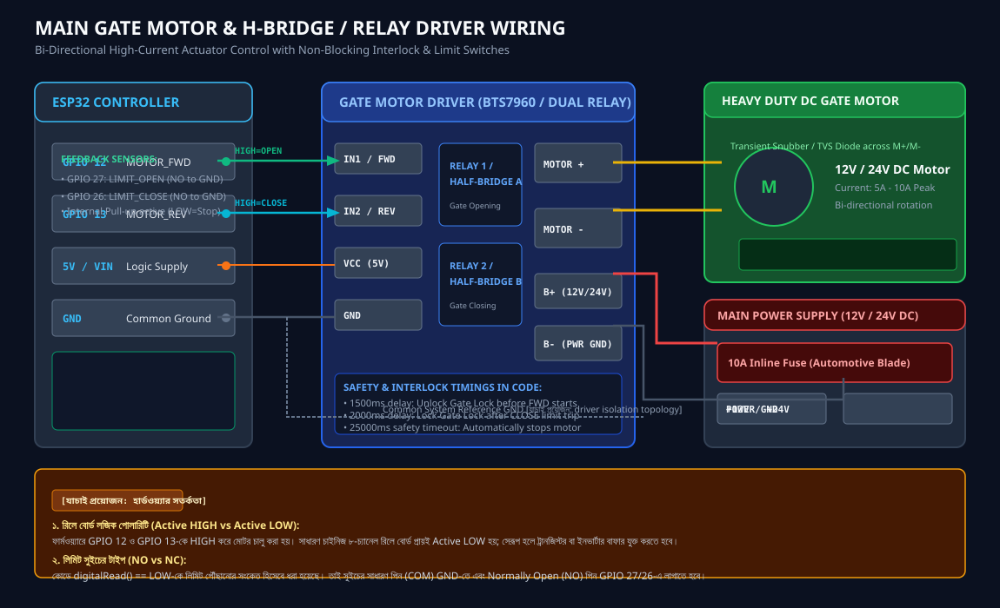

### ক. ছবির উদ্দেশ্য
স্লাইডিং বা সুইং গেটের ১২V/২৪V ডিসি মোটরকে কীভাবে হাই-কারেন্ট H-Bridge ড্রাইভার (যেমন BTS7960, IBT-2) অথবা ডুয়াল ৩০A রিলে মডিউলের মাধ্যমে নিরাপদে নিয়ন্ত্রণ করা যায় তা প্রদর্শন করা।

### খ. পিন-টু-পিন সংযোগ সারণী

| উৎস টার্মিনাল | গন্তব্য টার্মিনাল | তারের ধরন ও রঙ | কাজ |
| :--- | :--- | :--- | :--- |
| **ESP32 GPIO 12** | ড্রাইভার IN1 / FWD | সংকেত তার (সবুজ) | গেট খোলার কমান্ড (HIGH = রান) |
| **ESP32 GPIO 13** | ড্রাইভার IN2 / REV | সংকেত তার (নীল) | গেট বন্ধের কমান্ড (HIGH = রান) |
| **ESP32 5V (VIN)** | ড্রাইভার Logic VCC | পাওয়ার তার (কমলা) | ড্রাইভার লজিক পাওয়ার (৫V) |
| **ESP32 GND** | ড্রাইভার Logic GND | গ্রাউন্ড তার (কালো) | কমন লজিক রেফারেন্স গ্রাউন্ড |
| **12V/24V SMPS (+)** | 10A Blade Fuse -> ড্রাইভার B+ | পাওয়ার তার (লাল, ২.৫ মিমি²) | মোটরের প্রধান উচ্চ-বিদ্যুৎ সরবরাহ |
| **12V/24V SMPS (-)** | ড্রাইভার B- (PWR GND) | গ্রাউন্ড তার (কালো, ২.৫ মিমি²) | মোটরের প্রধান পাওয়ার গ্রাউন্ড |
| **ড্রাইভার MOTOR +** | ডিসি গেট মোটর টার্মিনাল ১ | ভারী তার (হলুদ, ২.৫ মিমি²) | মোটরের দ্বিমুখী ড্রাইভ |
| **ড্রাইভার MOTOR -** | ডিসি গেট মোটর টার্মিনাল ২ | ভারী তার (হলুদ, ২.৫ মিমি²) | মোটরের দ্বিমুখী ড্রাইভ |
| **ESP32 GPIO 27** | LIMIT_OPEN সুইচ (NO কন্টাক্ট) | সংকেত তার (সবুজ) | গেট পুরো খুললে মোটর থামানো |
| **ESP32 GPIO 26** | LIMIT_CLOSE সুইচ (NO কন্টাক্ট) | সংকেত তার (সবুজ) | গেট পুরো বন্ধ হলে মোটর থামানো |
| **ESP32 GND** | লিমিট সুইচ কমন (COM কন্টাক্ট) | গ্রাউন্ড তার (কালো) | সুইচের গ্রাউন্ড রিটার্ন |

### গ. কম্পোনেন্ট অবস্থান ও সুরক্ষা ব্যবস্থার ভূমিকা
1. **১০A ইনলাইন ব্লেড ফিউজ:** মোটরের প্রধান পাওয়ার লাইনে মোটর জ্যাম হওয়া বা যান্ত্রিক বাধার কারণে অতিরিক্ত কারেন্ট টানা প্রতিরোধ করে।
2. **Snubber / TVS Diode:** মোটরের টার্মিনালে মোটরের রিভার্স ইন্ডাক্টিভ স্পাইক (Back-EMF) শোষণ করে ড্রাইভার চিপ পুড়ে যাওয়া রোধ করে।
3. **১৫০০ms ওপেন ইন্টারলক টাইমার:** কোডে গেট খোলার আগে প্রথমে ড্রপবোল্ট আনলক করা হয় এবং ১৫০০ms অপেক্ষা করা হয়, যাতে লক মেকানিকালভাবে সম্পূর্ণ মুক্ত হওয়ার পর মোটর চলতে শুরু করে।
4. **২০০০ms ক্লোজ ইন্টারলক টাইমার:** গেট বন্ধের লিমিট সুইচে পৌঁছার পর মোটর বন্ধ করে অতিরিক্ত ২০০০ms অপেক্ষা করে ড্রপবোল্ট লক নামানো হয়।
5. **২৫ সেকেন্ড সেফটি টাইমআউট:** যদি লিমিট সুইচ কোনো কারণে ভেঙে যায় বা তার ছিঁড়ে যায়, তবে ২৫ সেকেন্ড পর কোড স্বয়ংক্রিয়ভাবে মোটর বন্ধ করে দেবে।

### ঘ. সিগন্যাল স্টেট তালিকা
- **Idle / Stopped:** GPIO 12 = `LOW` (0V), GPIO 13 = `LOW` (0V)।
- **Opening:** GPIO 12 = `HIGH` (3.3V), GPIO 13 = `LOW` (0V)।
- **Closing:** GPIO 12 = `LOW` (0V), GPIO 13 = `HIGH` (3.3V)।
- **Limit Tripped:** সংশ্লিষ্ট লিমিট পিন = `LOW` (0V), স্বাভাবিক অবস্থায় = `HIGH` (3.3V)।

### ঙ. মাল্টিমিটার দিয়ে সংযোগ যাচাইয়ের ধাপ
1. মোটর সংযোগ বিচ্ছিন্ন রেখে মাল্টিমিটার DC ভোল্টেজ মোডে রাখুন।
2. ESP32-এর GPIO 12 এবং GND-তে প্রোব ধরুন। Home Assistant বা বাটন চেপে ওপেন কমান্ড দিন। মিটারে ৩.৩V শো করবে এবং ১৫০০ms পর রিলে/ড্রাইভার ক্লিক করবে।
3. ড্রাইভারের MOTOR+ এবং MOTOR- টার্মিনালে ভোল্টেজ মেপে দেখুন ১২V/২৪V পাওয়া যায় কিনা। রিভার্স কমান্ড দিলে পোলারিটি উল্টে যাবে (-১২V)।
4. লিমিট সুইচ চেপে ধরে Continuity মেপে দেখুন COM এবং NO পিন শর্ট হয়ে বিপ শব্দ করে কিনা।

> [!CAUTION]
> **`[যাচাই প্রয়োজন: রিলে বোর্ড লজিক]`**: সাধারণ চাইনিজ ৮-চ্যানেল রিলে বোর্ডগুলো প্রায়ই **Active LOW** (ইনপুটে 0V দিলে অন হয়)। কিন্তু এই ফার্মওয়্যার **Active HIGH** (ইনপুটে 3.3V দিলে মোটর অন হয়)। আপনি যদি রিলে বোর্ড ব্যবহার করেন, নিশ্চিত করুন বোর্ডটি Active HIGH মোডে কনফিগার করা আছে (অথবা জাম্পার হাই লেভেলে সেট করা আছে)।

---

## 5. ৪-চ্যানেল ডোর ও গেট লক ড্রাইভার সার্কিট (Lock Actuator Drivers)

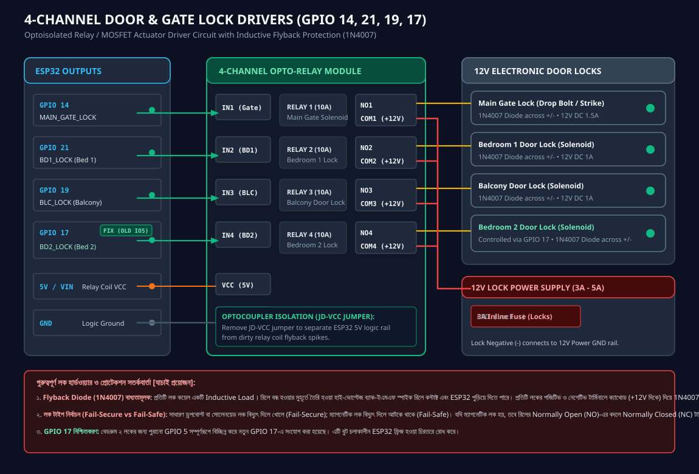

### ক. ছবির উদ্দেশ্য
মেইন গেট, বেডরুম ১, বারান্দা এবং বেডরুম ২-এর ১২V সোলেনয়েড বা ম্যাগনেটিক লককে কীভাবে অপ্টো-আইসোলেটেড রিলে বা MOSFET বোর্ডের মাধ্যমে পরিচালনা করতে হবে এবং ব্যাক-ইএমএফ স্পাইক রোধ করতে হবে তা উপস্থাপন করা।

### খ. পিন-টু-পিন সংযোগ সারণী

| ESP32 GPIO | রিলে চ্যানেল | রিলে ইনপুট | রিলে আউটপুট কন্টাক্ট | সংযুক্ত লক অ্যাকচুয়েটর | ফ্লাইব্যাক ডায়োড |
| :---: | :---: | :---: | :---: | :--- | :---: |
| **GPIO 14** | Channel 1 | IN1 | COM1 -> +12V, NO1 -> Lock+ | মেইন গেট সোলেনয়েড ড্রপবোল্ট | 1N4007 across Lock |
| **GPIO 21** | Channel 2 | IN2 | COM2 -> +12V, NO2 -> Lock+ | বেডরুম ১ ডোর লক সোলেনয়েড | 1N4007 across Lock |
| **GPIO 19** | Channel 3 | IN3 | COM3 -> +12V, NO3 -> Lock+ | বারান্দা ডোর লক সোলেনয়েড | 1N4007 across Lock |
| **GPIO 17** | Channel 4 | IN4 | COM4 -> +12V, NO4 -> Lock+ | বেডরুম ২ ডোর লক সোলেনয়েড | 1N4007 across Lock |
| **VIN (5V)** | VCC | VCC | - | রিলে লজিক সরবরাহ | - |
| **GND** | GND | GND | - | রিলে লজিক গ্রাউন্ড | - |
| **12V PSU (+)** | - | - | 3A Fuse -> COM1,2,3,4 | লক পাওয়ার বাস (+12V) | - |
| **12V PSU (-)** | - | - | Lock Negative (-) Terminals | কমন পাওয়ার গ্রাউন্ড | - |

### গ. উপাদানসমূহের ভূমিকা ও সুরক্ষাবিধি
1. **1N4007 Flyback Diodes (বাধ্যতামূলক):** ডোর লকের সোলেনয়েড কয়েল হলো একটি খাঁটি ইন্ডাক্টিভ লোড। রিলে অফ হওয়ার সাথে সাথে কয়েল থেকে ১০০-২০০ ভোল্টের একটি রিভার্স ভোল্টেজ স্পাইক তৈরি হয়। প্রতিটি লকের পজিটিভ ও নেগেটিভ টার্মিনালে ক্যাথোড (সাদা দাগ) +12V-এর দিকে দিয়ে প্যারালালে 1N4007 ডায়োড সংযোগ করতে হবে। এটি স্পাইককে নিজের ভেতর ডিসচার্জ করে ESP32 ও রিলেকে অক্ষত রাখে।
2. **৩A ইন্ডিপেন্ডেন্ট ব্লেড ফিউজ:** ৪টি লকের ১২V বাসে একটি ৩A ফিউজ ব্যবহার করা হয়। যদি কোনো লক কয়েল অতিরিক্ত গরম হয়ে শর্ট সার্কিট হয়, তবে এই ফিউজটি কেটে বাকি সিস্টেমকে সচল রাখবে।
3. **JD-VCC জাম্পার আইসোলেশন:** অপ্টো-রিলে বোর্ডের JD-VCC জাম্পার খুলে দিলে ESP32-এর ৫V লজিক এবং রিলের কয়েল ড্রাইভার সম্পূর্ণ অপ্টিক্যালি আলাদা থাকে।

### ঘ. মাল্টিমিটার টেস্টিং ধাপ
1. লক সংযোগ না করে মাল্টিমিটারকে DC Voltage মোডে সেট করুন।
2. রিলের NO এবং লকের গ্রাউন্ডের মাঝে প্রোব রাখুন।
3. ওয়েব ড্যাশবোর্ড থেকে সংশ্লিষ্ট লকটি 'LOCK' বা 'UNLOCK' করুন। রিলের লাল/সবুজ LED জ্বলবে, রিলে টিক শব্দ করবে এবং মিটারে ১২.০V দেখতে পাবেন।
4. ডায়োডের পোলারিটি ডায়োড টেস্ট মোডে পরীক্ষা করুন (ক্যাথোড +12V টার্মিনালে সংযুক্ত কিনা নিশ্চিত হোন)।

> [!IMPORTANT]
> **`[যাচাই প্রয়োজন: Fail-Secure vs Fail-Safe]`**:
> - ড্রপবোল্ট বা ইলেকট্রিক স্ট্রাইক লক বিদ্যুৎ দিলে আনলক হয় (**Fail-Secure**)। এক্ষেত্রে রিলের **Normally Open (NO)** ব্যবহার করা হয়।
> - ম্যাগনেটিক লক (EM Lock) বিদ্যুৎ দিলে আটকে থাকে (**Fail-Safe**)। এক্ষেত্রে রিলের **Normally Closed (NC)** টার্মিনাল ব্যবহার করতে হবে, যেন বিদ্যুৎ বিচ্ছিন্ন হলে দরজা স্বয়ংক্রিয়ভাবে মুক্ত হয়।

---

## 6. লক স্ট্যাটাস অপ্টোকপলার ও ১০kΩ পুল-ডাউন সার্কিট (Status Optocoupler Wiring)

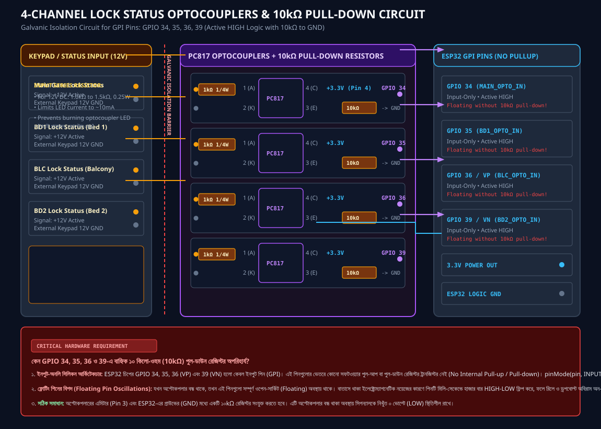

### ক. ছবির উদ্দেশ্য
বাইরের অ্যাক্সেস কন্ট্রোল কিপ্যাড বা ইন্টারকমের স্ট্যাটাস ফিডব্যাককে PC817 অপ্টোকপলারের মাধ্যমে কীভাবে ESP32-এর ইনপুট-অনলি পিনে (GPIO 34, 35, 36, 39) নিরাপদে ইনপুট দিতে হয় এবং কেন ১০kΩ রেজিস্টর অপরিহার্য তা তুলে ধরা।

### খ. পিন-টু-পিন ওয়্যারিং সারণী

| কিপ্যাড স্ট্যাটাস ইনপুট (12V) | PC817 পিন | সার্কিট উপাদান | ESP32 টার্মিনাল | লজিক অবস্থা |
| :--- | :---: | :--- | :--- | :---: |
| **Main Lock Status (+12V)** | Pin 1 (Anode) | ১kΩ ১/৪W রেজিস্টর সিরিজে | - | কিপ্যাড সিগন্যাল অন |
| **Keypad 12V Isolated GND** | Pin 2 (Cathode)| সরাসরি সংযোগ | - | কিপ্যাড গ্রাউন্ড |
| **ESP32 3.3V Logic Rail** | Pin 4 (Collector)| সরাসরি ৩.৩V সরবরাহ | - | লজিক হাই রেফারেন্স |
| **ESP32 GPIO 34 (GPI)** | Pin 3 (Emitter) | **১০kΩ রেজিস্টর to ESP32 GND** | GPIO 34 | Active HIGH (3.3V) |
| **BD1 Lock Status (+12V)** | Pin 1 (Anode) | ১kΩ ১/৪W রেজিস্টর সিরিজে | - | কিপ্যাড সিগন্যাল অন |
| **Keypad 12V Isolated GND** | Pin 2 (Cathode)| সরাসরি সংযোগ | - | কিপ্যাড গ্রাউন্ড |
| **ESP32 3.3V Logic Rail** | Pin 4 (Collector)| সরাসরি ৩.৩V সরবরাহ | - | লজিক হাই রেফারেন্স |
| **ESP32 GPIO 35 (GPI)** | Pin 3 (Emitter) | **১০kΩ রেজিস্টর to ESP32 GND** | GPIO 35 | Active HIGH (3.3V) |
| **BLC Lock Status (+12V)** | Pin 1 (Anode) | ১kΩ ১/৪W রেজিস্টর সিরিজে | - | কিপ্যাড সিগন্যাল অন |
| **Keypad 12V Isolated GND** | Pin 2 (Cathode)| সরাসরি সংযোগ | - | কিপ্যাড গ্রাউন্ড |
| **ESP32 3.3V Logic Rail** | Pin 4 (Collector)| সরাসরি ৩.৩V সরবরাহ | - | লজিক হাই রেফারেন্স |
| **ESP32 GPIO 36 (SENSOR_VP)**| Pin 3 (Emitter) | **১০kΩ রেজিস্টর to ESP32 GND** | GPIO 36 | Active HIGH (3.3V) |
| **BD2 Lock Status (+12V)** | Pin 1 (Anode) | ১kΩ ১/৪W রেজিস্টর সিরিজে | - | কিপ্যাড সিগন্যাল অন |
| **Keypad 12V Isolated GND** | Pin 2 (Cathode)| সরাসরি সংযোগ | - | কিপ্যাড গ্রাউন্ড |
| **ESP32 3.3V Logic Rail** | Pin 4 (Collector)| সরাসরি ৩.৩V সরবরাহ | - | লজিক হাই রেফারেন্স |
| **ESP32 GPIO 39 (SENSOR_VN)**| Pin 3 (Emitter) | **১০kΩ রেজিস্টর to ESP32 GND** | GPIO 39 | Active HIGH (3.3V) |

### গ. কেন ১০kΩ বাহ্যিক পুল-ডাউন রেজিস্টর অপরিহার্য? (Crucial Engineering Analysis)
1. **সিলিকন সীমাবদ্ধতা (No Internal Pull-down):** ESP32 চিপের GPIO 34, 35, 36 ও 39 হলো কেবল ইনপুট পিন (GPI)। এদের ভেতরে কোনো অভ্যন্তরীণ পুল-আপ বা পুল-ডাউন রেজিস্টর তৈরি করা নেই। কোডে `pinMode(pin, INPUT_PULLDOWN)` লিখলেও হার্ডওয়্যারে কোনো প্রভাব পড়ে না।
2. **ফ্লোটিং ইনপুট ও ঘোস্ট ট্রিগারিং:** যখন অপ্টোকপলার বন্ধ থাকে, ট্রানজিস্টর কাট-অফ অবস্থায় চলে যায়। ফলে পিনটি সম্পূর্ণ বিচ্ছিন্ন (Floating) অবস্থায় বাতাসে ভাসতে থাকে। বাতাসে থাকা সামান্য ইলেক্ট্রোম্যাগনেটিক ফিল্ডেই পিনটি হাই-লো ফ্লিপ করতে শুরু করে এবং লক অবিরাম অন-অফ হতে থাকে।
3. **সমাধান:** অপ্টোকপলারের এমিটার (Pin 3) এবং ESP32 GND-এর মাঝে একটি **১০kΩ রেজিস্টর** লাগালে অপ্টোকপলার বন্ধ থাকা অবস্থায় পিনটি নিখুঁত ০V (LOW)-এ স্থিতিশীল থাকে। অপ্টোকপলার অন হলে পিনটি ৩.৩V (HIGH) গ্রহণ করে।

### ঘ. মাল্টিমিটার ভেরিফিকেশন পদ্ধতি
1. মাল্টিমিটার DC Voltage মোডে নিন। নেগেটিভ প্রোব ESP32 GND-তে রাখুন।
2. পজিটিভ প্রোব GPIO 34/35/36/39 পিনে ধরুন।
3. কিপ্যাড নিষ্ক্রিয় অবস্থায় ভোল্টেজ ঠিক **০.০ ভোল্ট** দেখাচ্ছে কিনা নিশ্চিত হোন। যদি ০.৮V বা ১.২V দেখায়, বুঝবেন ১০kΩ রেজিস্টর সঠিকভাবে গ্রাউন্ডে লাগেনি।
4. কিপ্যাডে কার্ড/পাসওয়ার্ড পাঞ্চ করলে পিনে **৩.৩ ভোল্ট** উঠবে।

> [!WARNING]
> **`[যাচাই প্রয়োজন: কিপ্যাড সিগন্যাল ভোল্টেজ]`**: আপনার আউটডোর কিপ্যাডের স্ট্যাটাস আউটপুট যদি ১২V না হয়ে ৫V বা ২৪V হয়, তবে ১kΩ রেজিস্টরের মান পরিবর্তন করতে হবে:
> - ৫V ইনপুটের জন্য: ৩৩০Ω - ৪৭০Ω
> - ১২V ইনপুটের জন্য: ১.০kΩ - ১.৫kΩ
> - ২৪V ইনপুটের জন্য: ২.২kΩ - ২.৭kΩ

---

## 7. কিপ্যাড কলিং-বেল অপ্টোকপলার সার্কিট (Bell/Event Optocoupler Wiring)

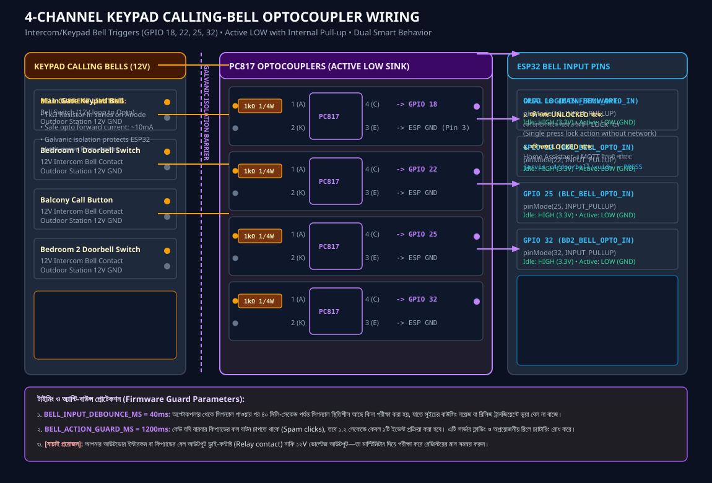

### ক. ছবির উদ্দেশ্য
বাইরের দরজার কিপ্যাডের কলিং-বেল বাটনকে PC817 অপ্টোকপলারের মাধ্যমে ESP32-এর GPIO 18, 22, 25, 32-তে ইন্টিগ্রেট করে কীভাবে দ্বিমুখী স্থানীয় ও ক্লাউড অটোমেশন তৈরি করা হয়েছে তা দেখানো।

### খ. পিন-টু-পিন সংযোগ সারণী

| কলিং বেল ইনপুট উৎস | PC817 পিন | আউটপুট সাইড সংযোগ | ESP32 GPIO | লজিক অবস্থা |
| :--- | :---: | :--- | :---: | :---: |
| **Main Gate Bell Switch (12V)** | Pin 1 & 2 | ১kΩ রেজিস্টর মাধ্যমে ১২V লুপ | - | কল বাটন চাপা |
| **ESP32 Logic Ground** | Pin 3 (Emitter)| সরাসরি ESP32 GND-তে | GND | গ্রাউন্ড সিঙ্ক |
| **ESP32 GPIO 18** | Pin 4 (Collector)| অভ্যন্তরীণ পুল-আপ সক্রিয় | **GPIO 18** | Active LOW (0V) |
| **BD1 Bell Switch (12V)** | Pin 1 & 2 | ১kΩ রেজিস্টর মাধ্যমে ১২V লুপ | - | কল বাটন চাপা |
| **ESP32 Logic Ground** | Pin 3 (Emitter)| সরাসরি ESP32 GND-তে | GND | গ্রাউন্ড সিঙ্ক |
| **ESP32 GPIO 22** | Pin 4 (Collector)| অভ্যন্তরীণ পুল-আপ সক্রিয় | **GPIO 22** | Active LOW (0V) |
| **BLC Bell Switch (12V)** | Pin 1 & 2 | ১kΩ রেজিস্টর মাধ্যমে ১২V লুপ | - | কল বাটন চাপা |
| **ESP32 Logic Ground** | Pin 3 (Emitter)| সরাসরি ESP32 GND-তে | GND | গ্রাউন্ড সিঙ্ক |
| **ESP32 GPIO 25** | Pin 4 (Collector)| অভ্যন্তরীণ পুল-আপ সক্রিয় | **GPIO 25** | Active LOW (0V) |
| **BD2 Bell Switch (12V)** | Pin 1 & 2 | ১kΩ রেজিস্টর মাধ্যমে ১২V লুপ | - | কল বাটন চাপা |
| **ESP32 Logic Ground** | Pin 3 (Emitter)| সরাসরি ESP32 GND-তে | GND | গ্রাউন্ড সিঙ্ক |
| **ESP32 GPIO 32** | Pin 4 (Collector)| অভ্যন্তরীণ পুল-আপ সক্রিয় | **GPIO 32** | Active LOW (0V) |

### গ. ফার্মওয়্যারের দ্বিমুখী স্মার্ট বিহেভিয়ার (Dual Behavior Logic)
ফার্মওয়্যারের `handleBellOptoInputs()` ফাংশনে একটি বুদ্ধিমান সিকোয়েন্স যুক্ত রয়েছে:
1. **দরজা যদি আনলকড অবস্থায় থাকে:** কিপ্যাডের কল বাটন চাপলে সিস্টেম বুঝে নেয় ব্যক্তি বের হয়ে গেছেন বা ঘর লক করতে চান। তাই কোনো ক্লাউড মেসেজ না পাঠিয়ে তাৎক্ষণিকভাবে সরাসরি রিলেতে **"LOCK"** কমান্ড ইস্যু করা হয়।
2. **দরজা যদি ইতিমধ্যে লকড অবস্থায় থাকে:** সিস্টেম নিশ্চিত হয় যে ঘরে কেউ প্রবেশের জন্য বেল বাজাচ্ছেন। তখন লোকাল লক পরিবর্তন না করে সাথে সাথে Home Assistant-এ নন-রিটেইন্ড MQTT মেসেজ পাঠানো হয়:
   - টপিক: `jarvis_v4/doorbell/<lock_uid>`
   - পেলোড: `PRESS`

### ঘ. টাইমিং ফিল্টার প্যারামিটার
- `BELL_INPUT_DEBOUNCE_MS = 40ms`: মেকানিক্যাল বাউন্স ফিল্টারিং।
- `BELL_ACTION_GUARD_MS = 1200ms`: দর্শনার্থী বারবার বেল বাজাতে থাকলে প্রতি ১.২ সেকেন্ডে কেবল ১টি ইভেন্ট প্রক্রিয়া করা হয়।

---

## 8. পুশ বাটন, লিমিট সুইচ ও স্ট্যাটাস LED ওয়্যারিং (Buttons, Sensors & LED)

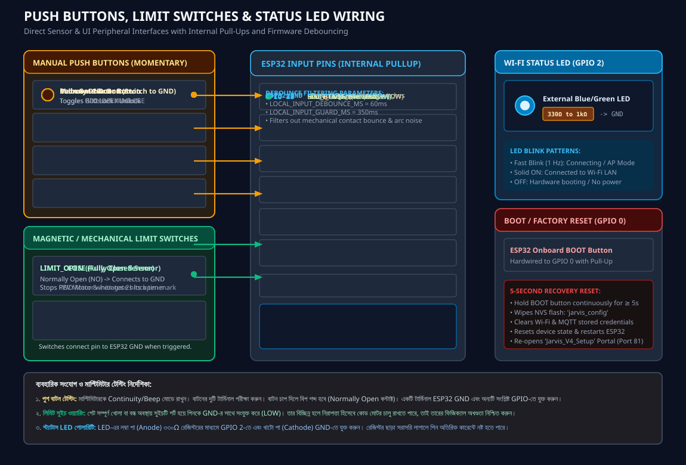

### ক. ছবির উদ্দেশ্য
ম্যানুয়াল পুশ বাটন, গেটের ম্যাগনেটিক লিমিট সুইচ, সিস্টেম ওয়াই-ফাই স্ট্যাটাস LED এবং ফ্যাক্টরি রিসেট বাটন কীভাবে ESP32-এর সাথে সরাসরি যুক্ত তা প্রদর্শন করা।

### খ. সংযোগ সারণী ও ফিল্টারিং স্পেসিফিকেশন

| কম্পোনেন্ট | ESP32 GPIO | পিন মোড | সক্রিয় লজিক অবস্থা | সাধারণ বা নিষ্ক্রিয় অবস্থা | ফার্মওয়্যার ফিল্টার |
| :--- | :---: | :---: | :---: | :---: | :---: |
| **Main Gate Push Button** | **GPIO 33** | INPUT_PULLUP | LOW (বাটন চাপলে GND শর্ট) | HIGH (3.3V) | 60ms Debounce, 350ms Guard |
| **BD1 Push Button** | **GPIO 4** | INPUT_PULLUP | LOW (বাটন চাপলে GND শর্ট) | HIGH (3.3V) | 60ms Debounce, 350ms Guard |
| **BLC Push Button** | **GPIO 23** | INPUT_PULLUP | LOW (বাটন চাপলে GND শর্ট) | HIGH (3.3V) | 60ms Debounce, 350ms Guard |
| **BD2 Push Button** | **GPIO 16** | INPUT_PULLUP | LOW (বাটন চাপলে GND শর্ট) | HIGH (3.3V) | 60ms Debounce, 350ms Guard |
| **LIMIT_OPEN Switch** | **GPIO 27** | INPUT_PULLUP | LOW (গেট খুললে ম্যাগনেট শর্ট) | HIGH (3.3V) | তাত্ক্ষণিক মোটর স্টপ |
| **LIMIT_CLOSE Switch** | **GPIO 26** | INPUT_PULLUP | LOW (গেট বন্ধ হলে ম্যাগনেট শর্ট)| HIGH (3.3V) | মোটর স্টপ + ২ সে. লক টাইমার |
| **Wi-Fi Status LED** | **GPIO 2** | OUTPUT | HIGH (৩৩০Ω রেজিস্টর দিয়ে LED জ্বলে)| LOW (LED বন্ধ) | 1 Hz Blink (AP) / Solid (LAN) |
| **Onboard BOOT Button** | **GPIO 0** | INPUT_PULLUP | LOW (৫ সেকেন্ড ধরে চেপে রাখলে) | HIGH (3.3V) | সম্পূর্ণ NVS ও Wi-Fi রিসেট |

### গ. স্ট্যাটাস LED ও ফ্যাক্টরি রিসেট ব্যবহারবিধি
1. **LED ফাস্ট ব্লিঙ্ক (প্রতি সেকেন্ডে ১ বার):** ESP32 ওয়াই-ফাই সংযোগের চেষ্টা করছে অথবা সেটআপ পোর্টাল সক্রিয় রয়েছে (`Jarvis_V4_Setup`)।
2. **LED একটানা অন (Solid ON):** ESP32 সফলভাবে রাউটারে কানেক্টেড এবং লোকাল নেটওয়ার্কে প্রস্তুত।
3. **ফ্যাক্টরি রিসেট পদ্ধতি:** ESP32 বোর্ডের অনবোর্ড **BOOT বাটন (GPIO 0)** একটানা **৫ সেকেন্ড** চেপে ধরে রাখলে Preferences ফ্ল্যাশ মেমরির `jarvis_config` ও `jarvis_v4_final` মুছে যাবে এবং ESP32 রিস্টার্ট নিয়ে পুনরায় পোর্ট ৮১-তে কনফিগারেশন পোর্টাল ওপেন করবে।

---

## 9. পাওয়ার ডিস্ট্রিবিউশন, ফিউজ ও প্রোটেকশন সার্কিট (Power & Protection)

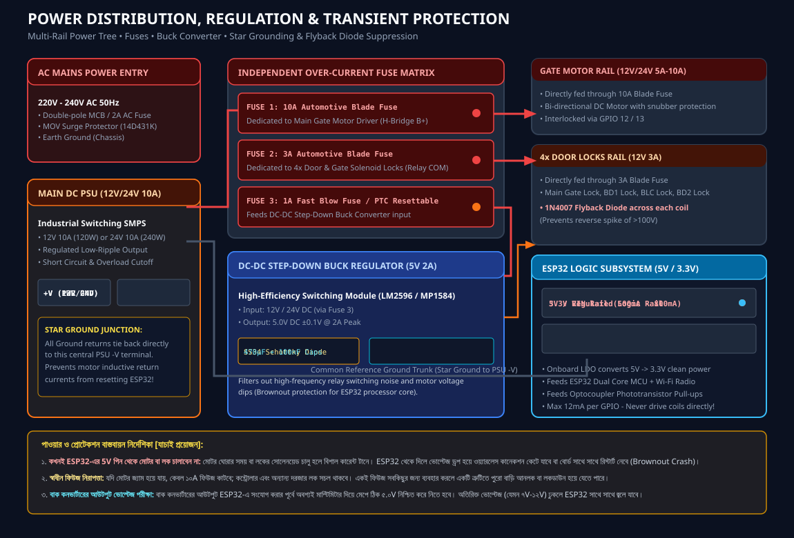

### ক. ছবির উদ্দেশ্য
একটি পরিষ্কার পাওয়ার ট্রি (Power Tree) ডায়াগ্রামের মাধ্যমে দেখানো হয়েছে কীভাবে এসি মেইনস থেকে ১২V/২৪V ডিসি পাওয়ার তৈরি হয়, কীভাবে তিনটি স্বাধীন ফিউজে বিভক্ত হয় এবং কীভাবে বাক কনভার্টারের মাধ্যমে নয়েজ-মুক্ত ৫V তৈরি করে ESP32-কে ব্রাউন-আউট থেকে রক্ষা করা হয়।

### খ. পাওয়ার রেল ও ফিউজ স্পেসিফিকেশন

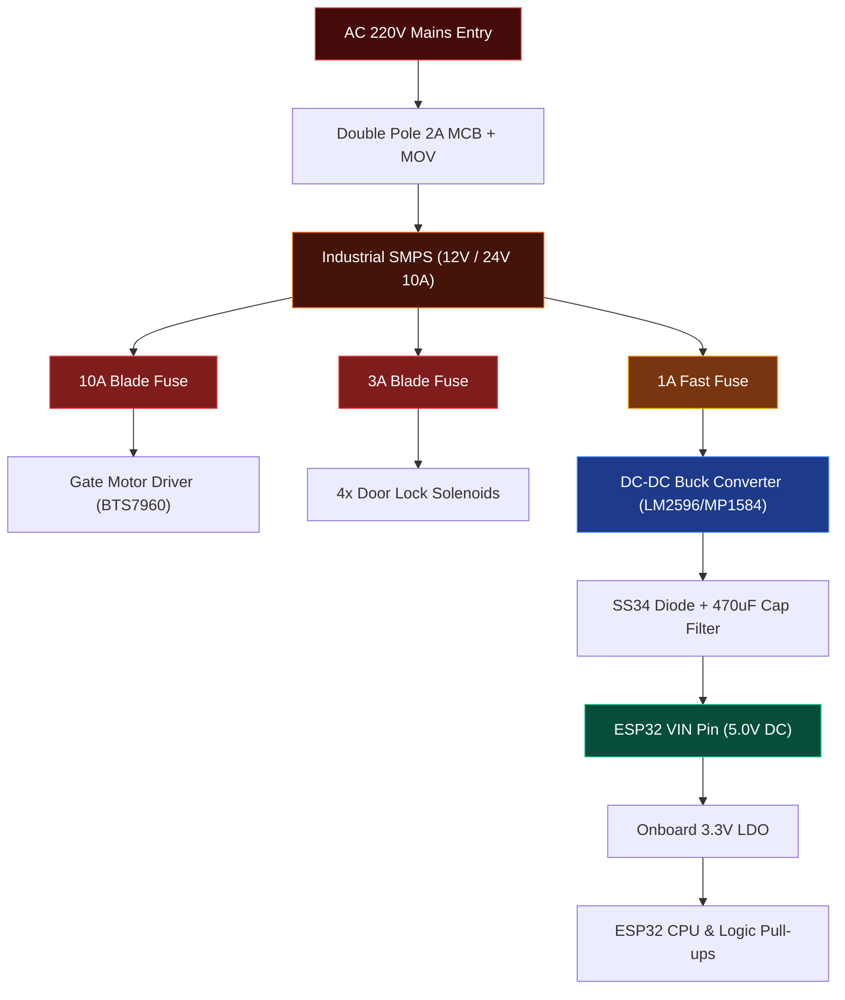

### গ. স্টার গ্রাউন্ডিং (Star Grounding Architecture)
মোটর যখন স্টার্ট নেয়, তখন ৫ থেকে ১০ অ্যাম্পিয়ার কারেন্ট গ্রাউন্ড লাইন দিয়ে প্রবাহিত হয়। সাধারণ সিস্টেমে চিকন তারে এই রিটার্ন কারেন্টের কারণে গ্রাউন্ড ভোল্টেজ ০V থেকে সাময়িকভাবে ১-২ ভোল্টে লাফিয়ে ওঠে। একে **Ground Bounce** বলে, যা নিমেষেই ESP32-কে রিবুট করে দেয়।
- **সমাধান:** সমস্ত গ্রাউন্ড তারকে চেইন আকারে না জুড়ে এসএমপিএস-এর প্রধান `-V` টার্মিনাল থেকে তারার মতো পৃথকভাবে (Star Ground) মোটর ড্রাইভার, লক এবং ESP32-তে নিয়ে যেতে হবে।

---

## 10. যোগাযোগ আর্কিটেকচার: Home Assistant ও MQTT (Communication Architecture)

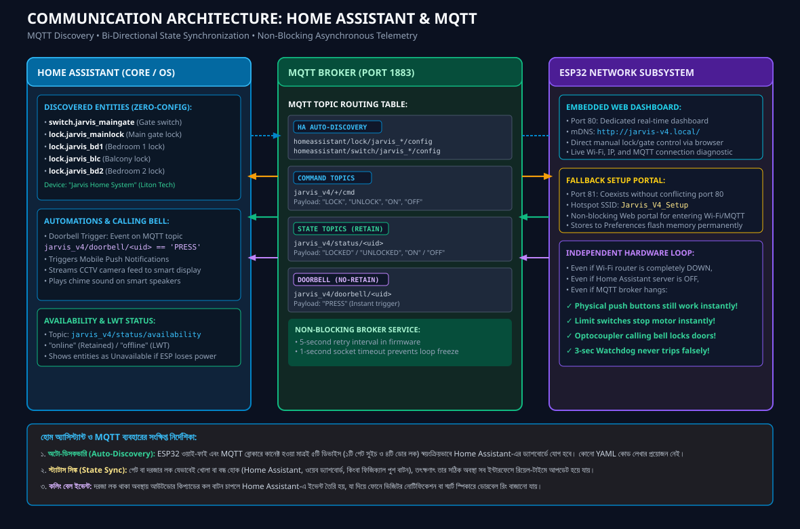

### ক. ছবির উদ্দেশ্য
Home Assistant, লোকাল MQTT ব্রোকার (Mosquitto/EMQX) এবং ESP32-এর মধ্যে ডেটা আদান-প্রদান, জিরো-কনফিগারেশন অটো-ডিসকভারি ও নন-ব্লকিং টেলিমিতি প্রদর্শন করা।

### খ. MQTT টপিক হায়ারার্কি টেবিল

| টপিকের ধরণ | সম্পূর্ণ MQTT টপিক পাথ | পেলোড ফরম্যাট | রিটেইন ফ্ল্যাগ | বিবরণ |
| :--- | :--- | :---: | :---: | :--- |
| **Availability** | `jarvis_v4/status/availability` | `online` / `offline` | **True** | LWT স্ট্যাটাস |
| **Gate State** | `jarvis_v4/status/maingate` | `ON` / `OFF` | **True** | গেটের বর্তমান অবস্থা |
| **Gate Command**| `jarvis_v4/maingate/cmd` | `ON` / `OFF` | False | গেট ওপেন/ক্লোজ কমান্ড |
| **Lock States** | `jarvis_v4/status/<uid>` | `LOCKED` / `UNLOCKED`| **True** | ৪টি লকের রিয়েলটাইম অবস্থা |
| **Lock Command**| `jarvis_v4/<uid>/cmd` | `LOCK` / `UNLOCK` | False | লক খোলা/আটকানোর কমান্ড |
| **Doorbell Event**| `jarvis_v4/doorbell/<uid>` | `PRESS` | **False** | কিপ্যাড কলিং বেল ইভেন্ট |

> `<uid>` এর সম্ভাব্য মানসমূহ: `mainlock`, `bd1`, `blc`, `bd2`।

### গ. Home Assistant ড্যাশবোর্ড কার্ড (Lovelace YAML)

```yaml
type: entities
title: 🛡️ JARVIS V4 Master Access Control
show_header_toggle: false
entities:
  - entity: switch.jarvis_maingate
    name: মেইন স্লাইডিং গেট
    icon: mdi:gate
  - entity: lock.jarvis_mainlock
    name: মেইন গেট ড্রপবোল্ট লক
  - entity: lock.jarvis_bd1
    name: বেডরুম ১ ডোর লক
  - entity: lock.jarvis_blc
    name: বারান্দা ডোর লক
  - entity: lock.jarvis_bd2
    name: বেডরুম ২ ডোর লক (GPIO 17)
```

### ঘ. কলিং বেল অটোমেশন উদাহরণ (Home Assistant Automation YAML)

```yaml
alias: "Jarvis Doorbell Notification"
trigger:
  - platform: mqtt
    topic: "jarvis_v4/doorbell/mainlock"
    payload: "PRESS"
action:
  - service: notify.notify
    data:
      title: "🔔 দরজায় দর্শনার্থী!"
      message: "মেইন গেটের কিপ্যাড বেল বাজানো হয়েছে।"
      data:
        image: "/api/camera_proxy/camera.front_gate"
```

---

## 11. ফার্মওয়্যার কনফিগারেশন ও ফ্ল্যাশিং নির্দেশিকা (Flashing & Setup)

### ক. প্রয়োজনীয় লাইব্রেরি তালিকা
Arduino IDE-এর Library Manager থেকে নিচের লাইব্রেরিগুলো ইনস্টল করুন:
1. `PubSubClient` (Nick O'Leary কর্তৃক) - v2.8+
2. `WiFiManager` (tzapu কর্তৃক) - v2.0.16-rc.2+
3. `Preferences` (ESP32 কোর বিল্ট-ইন)
4. `WebServer` (ESP32 কোর বিল্ট-ইন)
5. `ESPmDNS` (ESP32 কোর বিল্ট-ইন)

### খ. Arduino IDE বোর্ড সেটিংস
- **Board:** `ESP32 Dev Module`
- **CPU Frequency:** `240MHz (WiFi/BT)`
- **Flash Frequency:** `80MHz`
- **Flash Mode:** `QIO`
- **Flash Size:** `4MB (32Mb)`
- **Partition Scheme:** `Default 4MB with spiffs (1.2MB APP/1.5MB SPIFFS)`
- **Core Debug Level:** `None` (বা `Info` ডিবাগিংয়ের জন্য)

### গ. প্রথমবার ওয়াই-ফাই ও MQTT কনফিগারেশন পদ্ধতি
1. কোড আপলোড করার পর ESP32 চালু করুন।
2. যদি পূর্বে ওয়াই-ফাই সেভ করা না থাকে, তবে স্ট্যাটাস LED ব্লিঙ্ক করবে এবং `Jarvis_V4_Setup` নামে একটি ওপেন Wi-Fi হটস্পট চালু হবে।
3. মোবাইল বা ল্যাপটপ থেকে `Jarvis_V4_Setup`-এ কানেক্ট করুন। ক্যাপটিভ পোর্টাল স্বয়ংক্রিয়ভাবে খুলবে (অথবা ব্রাউজারে `http://192.168.4.1:81` প্রবেশ করুন)।
4. আপনার হোম ওয়াই-ফাই SSID, পাসওয়ার্ড, Home Assistant MQTT সার্ভার IP, পোর্ট (১৮৮৩), ইউজারনেম ও পাসওয়ার্ড লিখে **Save** চাপুন।
5. ESP32 রিস্টার্ট হয়ে রাউটারে কানেক্ট হবে এবং পরবর্তীতে যেকোনো ব্রাউজার থেকে `http://jarvis-v4.local/` ঠিকানায় লোকাল ড্যাশবোর্ড ওপেন হবে।

---

## 12. হার্ডওয়্যার প্রি-পাওয়ার-অন চেকলিস্ট (Pre-Power-On Verification)

প্রথমবার মেইন পাওয়ার সুইচে হাত দেওয়ার আগে নিচের ধাপগুলো পুঙ্খানুপুঙ্খভাবে যাচাই করুন:

| পরীক্ষা নম্বর | পরীক্ষার বিষয় | সঠিক মান / প্রত্যাশিত ফলাফল | অসঙ্গতি হলে করণীয় |
| :---: | :--- | :--- | :--- |
| **১** | বাক কনভার্টারের আউটপুট ভোল্টেজ | মাল্টিমিটারে ঠিক **৫.০V থেকে ৫.১V DC** | ট্রিমপটের স্ক্রু ঘুরিয়ে ভোল্টেজ ঠিক করুন; ভুলেও বেশি ভোল্টেজ ESP32-তে দেবেন না। |
| **২** | ১০kΩ পুল-ডাউন রেজিস্টর পরীক্ষা | GPIO 34, 35, 36, 39 এবং GND-র মাঝে **১০kΩ রেজিস্ট্যান্স** | রেজিস্টর ঠিকভাবে গ্রাউন্ডে কানেক্টেড কিনা নিশ্চিত হোন। |
| **৩** | লক ডায়োড পোলারিটি | ডায়োডের সাদা ব্যান্ড (ক্যাথোড) **+12V লাইনে** | উল্টো লাগালে পাওয়ার দেওয়া মাত্রই ডায়োড শর্ট হয়ে ফিউজ কাটবে। |
| **৪** | GPIO 17 রিলোকেশন যাচাই | বেডরুম ২ লকটি GPIO 5 থেকে সরিয়ে **GPIO 17**-এ লাগানো হয়েছে | পুরানো GPIO 5 তারটি সম্পূর্ণ খুলে ফাঁকা রাখুন। |
| **৫** | স্টার গ্রাউন্ড কন্টিনিউটি | মোটর গ্রাউন্ড, রিলে গ্রাউন্ড ও ESP GND-র মাঝে **০.০ ওহম** | সেন্ট্রাল এসএমপিএস `-V` টার্মিনালে সব গ্রাউন্ড টাই করুন। |
| **৬** | ফিউজের সঠিক রেটিং | মোটর: ১০A, লক বাস: ৩A, বাক কনভার্টার: ১A | কম বা বেশি মানের ফিউজ লাগানো থেকে বিরত থাকুন। |

---

## 📜 কপিরাইট ও কৃতজ্ঞতা

- **সিস্টেম আর্কিটেক্ট ও ফার্মওয়্যার:** Jarvis Automation Core Team
- **ফার্মওয়্যার সংস্করণ:** V4 Final (Non-blocking Engine with GPIO 17 Boot Fix)
- **লাইসেন্স:** MIT Open Hardware & Software Documentation License.

যেকোনো হার্ডওয়্যার ইনস্টলেশনের পূর্বে বৈদ্যুতিক নিরাপত্তা নিশ্চিত করুন এবং পেশাদার ইলেকট্রিশিয়ানের পরামর্শ গ্রহণ করুন।

